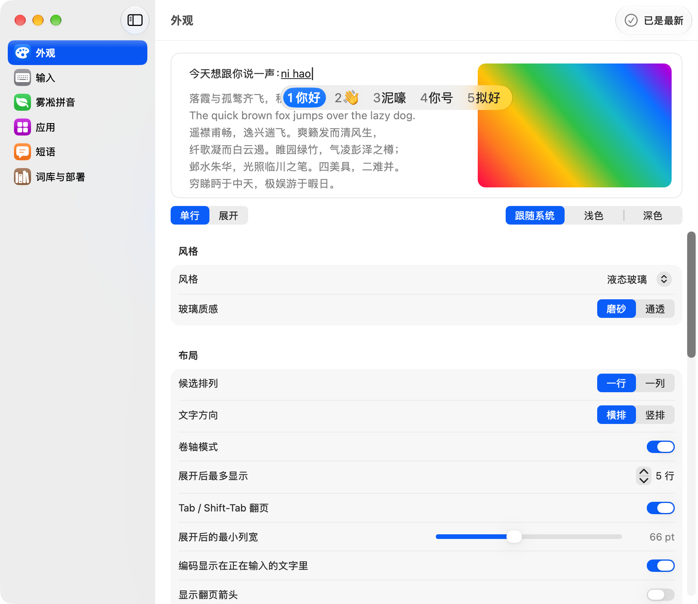
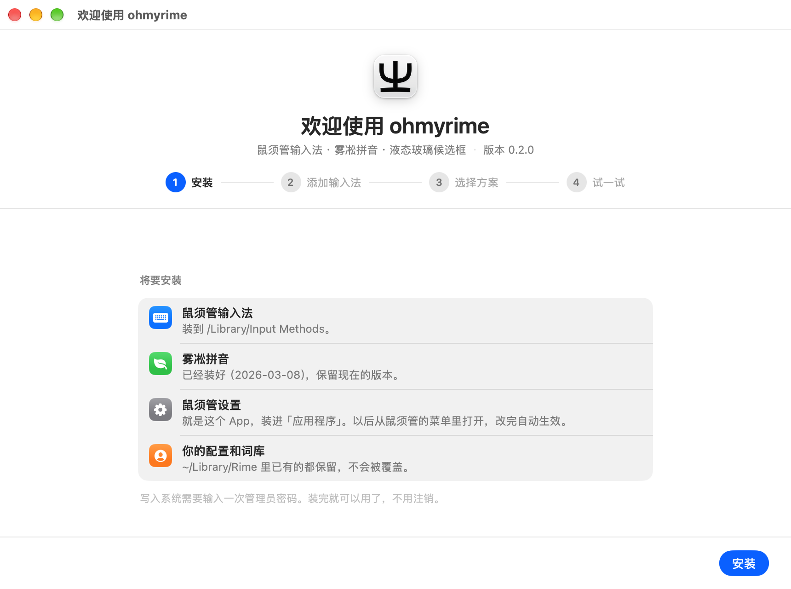
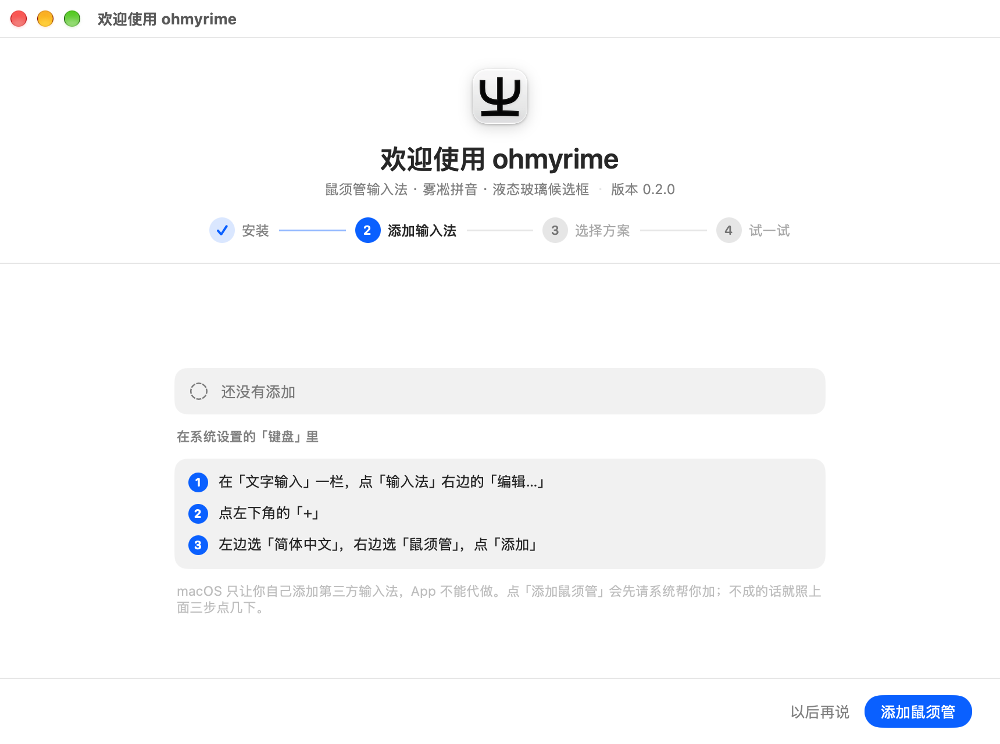
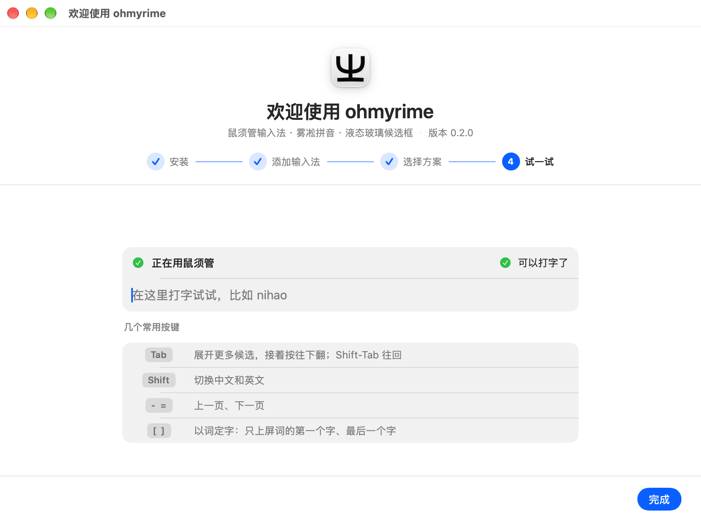
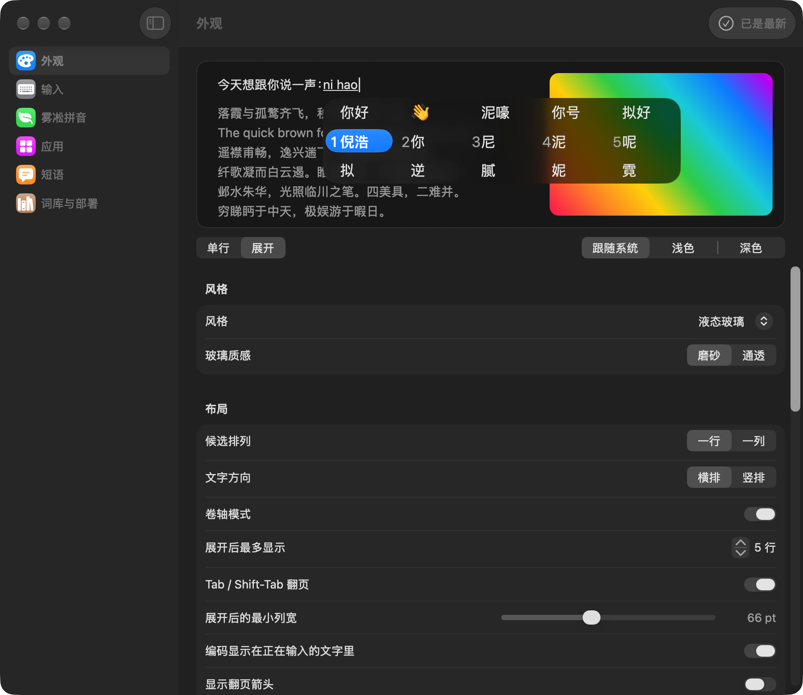
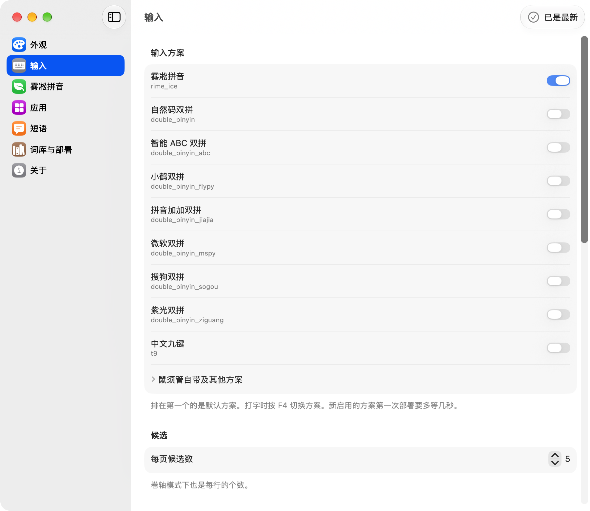
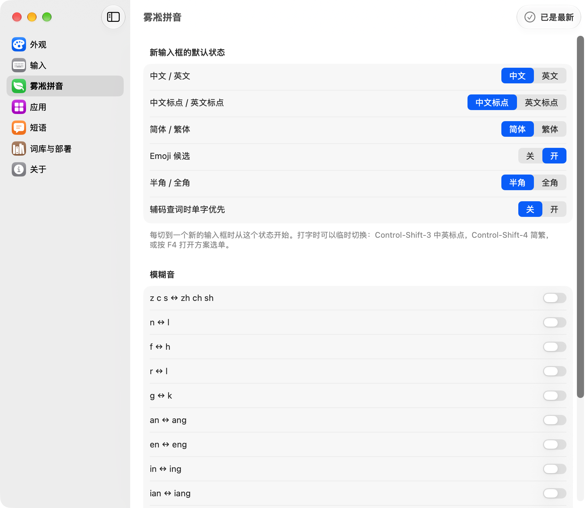
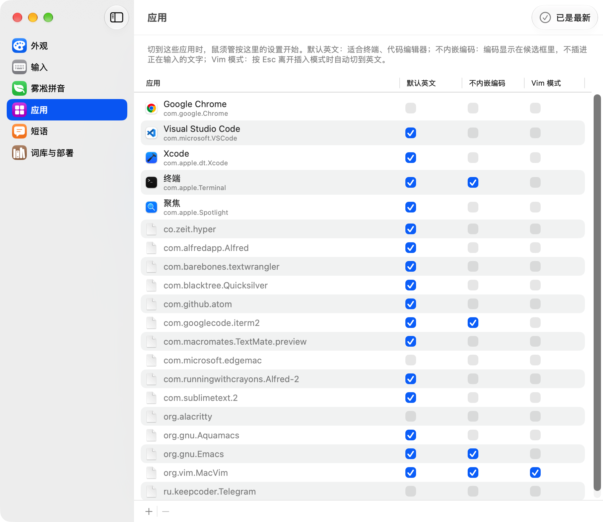
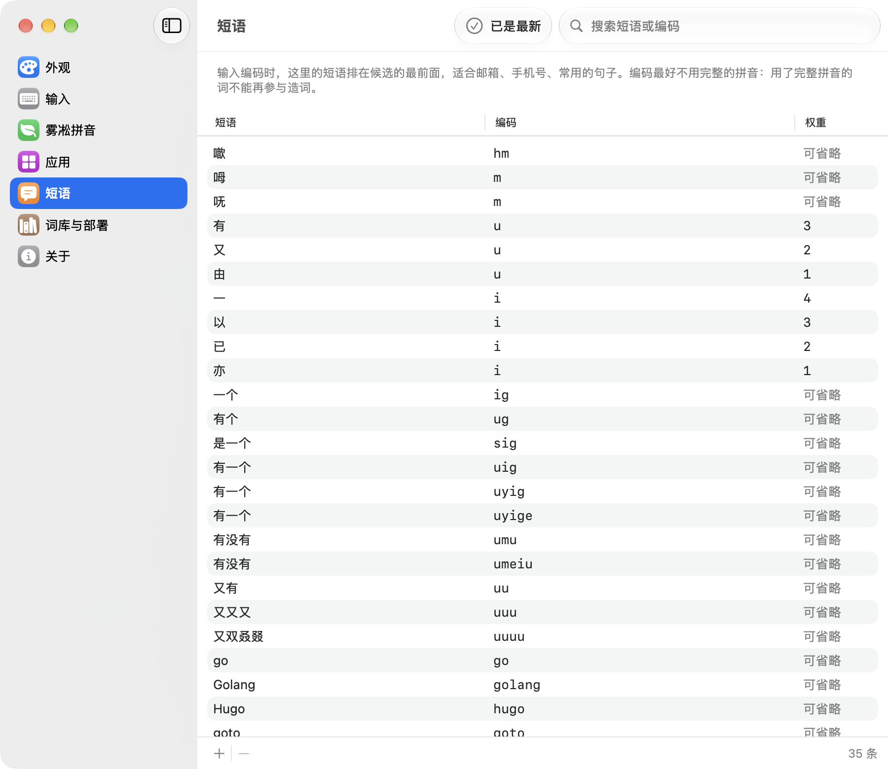
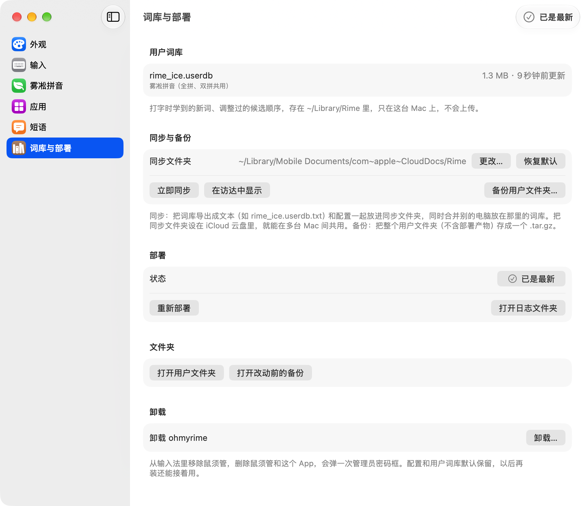

# ohmyrime

macOS 上的 Rime 输入法：鼠须管加上卷轴模式和液态玻璃候选框，默认用雾凇拼音，所有设置都能在「鼠须管设置」里点选。

## 安装

需要 Apple 芯片的 Mac，macOS 14 或更新（液态玻璃外观要 macOS 26）。鼠须管、雾凇拼音和这个设置 App 都在安装包里，装的时候不用联网。

1. 从 [Releases](https://github.com/tarnish233/ohmyrime/releases/latest) 下载 `ohmyrime.zip`，解压后双击「鼠须管设置」。
2. 这个 App 没有经过 Apple 公证，第一次打开会被系统拦下：打开「系统设置 → 隐私与安全性」，点「仍要打开」，输入密码。
3. 欢迎页点「安装」，输入一次管理员密码：鼠须管装到 `/Library/Input Methods`，雾凇拼音直接装进 `~/Library/Rime`。
4. 点「添加鼠须管」：系统可能先弹出确认框，点「允许」；没有直接加上的话，App 会打开系统设置的「键盘」页，照右上角提示卡点几下。加好后会自己打勾。
5. 选拼音方案和中英切换键，在「试一试」里打几个字就完成了。

从源码构建（需要 Xcode）：`git clone https://github.com/tarnish233/ohmyrime.git && cd ohmyrime && scripts/build.sh && scripts/install.sh`。

| | | |
|---|---|---|
|  **安装**：鼠须管和雾凇拼音都在这一个 App 里 |  **添加输入法**：照提示点几下，加好自动打勾 |  **试一试**：顺便告诉你几个常用按键 |

- 更新：下载新版 `ohmyrime.zip` 再装一次；你的配置和用户词库都保留。
- 卸载：设置 App 的「词库与部署 → 卸载」，或者 `bash scripts/uninstall.sh`。默认保留配置和词库。
- 遇到问题（打不出字、菜单里选不中鼠须管、第一次打开被拦）：见[常见问题](docs/development.md#常见问题)。

## 鼠须管设置

打开方式：鼠须管菜单里的「设置…」（⌃⌥,），或「应用程序」里的「鼠须管设置」。改完自动保存、立即生效，不用手改配置文件。

|                                                                                                          |                                                                             |
| -------------------------------------------------------------------------------------------------------- | --------------------------------------------------------------------------- |
|  **外观**：液态玻璃、卷轴模式、字体、间距、动效。顶部是实时预览，可以切换单行 / 展开、浅色 / 深色 |  **输入**：启用哪些方案，每页候选数，中英切换键，翻页键，以词定字 |
|  **雾凇拼音**：安装和更新，新输入框的默认状态，模糊音                                    |  **应用**：按应用设置默认英文、不内嵌编码、Vim 模式       |
|  **短语**：自定义短语，可以搜索                                             |  **词库与部署**：用户词库、iCloud 同步、备份、部署状态 |

卷轴模式的按键、各配置项、实现和开发说明见[技术文档](docs/development.md)。许可证：GPL-3.0。
